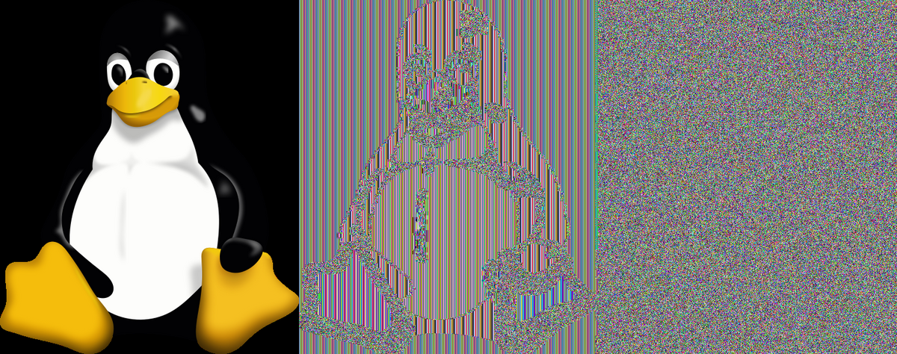

# AES in Haskell and C

**Authors:** Baptiste Joubert, Julien Albinet

> **Disclaimer:** this is an educational project written for a university course. It is **not** hardened against side-channel attacks, has not been audited, and must **not** be used to protect real data. Use a vetted library (OpenSSL, libsodium, ...) in production.

## Overview

A from-scratch implementation of the AES (Advanced Encryption Standard) block cipher, written twice:

- **Haskell**: focuses on the mathematics behind AES. Groups, rings and fields are built from scratch (Z/2Z, polynomial rings, GF(2⁸)), and the cipher is then expressed on top of them.
- **C**: an imperative implementation with lookup tables, plus ECB and CBC modes applied to BMP images.

Both follow [FIPS 197](https://nvlpubs.nist.gov/nistpubs/FIPS/NIST.FIPS.197.pdf).

## Correctness

- The C test suite checks each round transformation (SubBytes, ShiftRows, MixColumns, AddRoundKey and their inverses) and runs full encrypt/decrypt round trips on the **FIPS 197 Appendix C vectors for 128-, 192- and 256-bit keys**.
- The Haskell version is checked against the FIPS 197 Appendix B example (`3925841d02dc09fbdc118597196a0b32`).

## ECB vs CBC on an image

Original, ECB-encrypted, CBC-encrypted (left to right):



In ECB mode, identical plaintext blocks give identical ciphertext blocks, so the outline of the image is still visible. CBC chains the blocks and removes this pattern.

## Features

- AES-128, AES-192 and AES-256 (encryption and decryption)
- ECB and CBC modes
- BMP image reading/writing to visualise the effect of the modes
- Test programs in C and GHCi scripts in Haskell

## Project structure

```
C/            C implementation (see C/README.md)
Haskell/      Haskell implementation (see Haskell/README.md)
docs/         Images used in this README
```

### C (`C/`)

| File | Role |
|---|---|
| `F_AES.c/.h` | Core AES transformations and helpers, key expansion |
| `F_Inverse_AES.c/.h` | Inverse transformations (decryption) |
| `Cypher_InvCypher.c/.h` | Block encryption / decryption (`aes_encrypt`, `aes_decrypt`) |
| `ecb_encryption.c/.h`, `cbc_encryption.c/.h` | ECB and CBC modes |
| `bmp.c/.h` | BMP reading/writing, and the image demo `main` |
| `Table_de_multiplication.c/.h` | Precomputed GF(2⁸) multiplication tables |
| `generation_Table/` | Generator for those tables |
| `tests_AES.c` | Test program |

### Haskell (`Haskell/`)

`Group.hs`, `Anneau.hs`, `Corps.hs` (algebraic structures) → `Z_sur_2Z.hs`, `Polynome.hs`, `GF28.hs` (field arithmetic) → `AES.hs`, `Cypher.hs` (the cipher). `test_*.ghci` are test scripts.

## Build and run

### C

Requires `gcc` and `make`.

```bash
cd C
make test        # builds and runs the test suite (./aes_test)
make demo        # builds and runs the ECB/CBC image demo (./test_ecb)
make clean
```

`make demo` encrypts `Tux.bmp` in ECB (`Tux_encrypte.bmp`) and CBC (`Tux_encrypte2.bmp`), then decrypts both back (`Tux_decrypte*.bmp`). Run it from inside `C/`.

### Haskell

Requires GHC.

```bash
cd Haskell
ghci Cypher.hs
ghci> :script test_Cypher.ghci
```

The other scripts work the same way (`test_AES.ghci` with `AES.hs`, `test_Gf28.ghci` with `GF28.hs`, ...).

## Possible improvements

- SIMD / AES-NI optimisation of the C version
- More modes (CTR, GCM)
- A proper command-line interface (key, IV and file as arguments)

## License

MIT, see [LICENSE](LICENSE).
